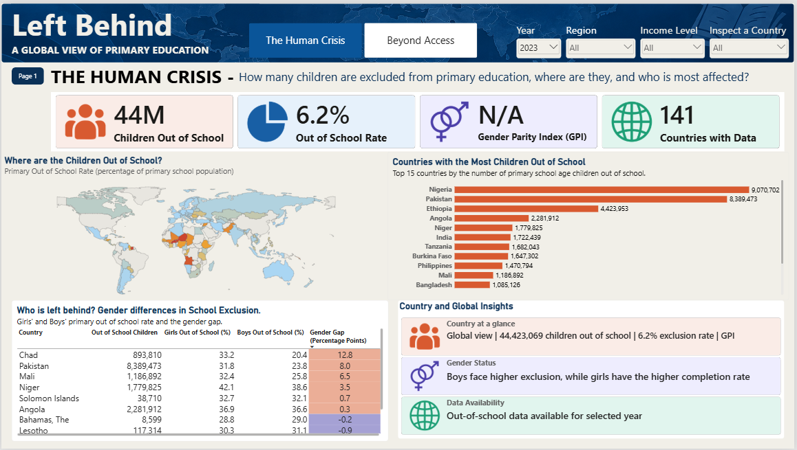
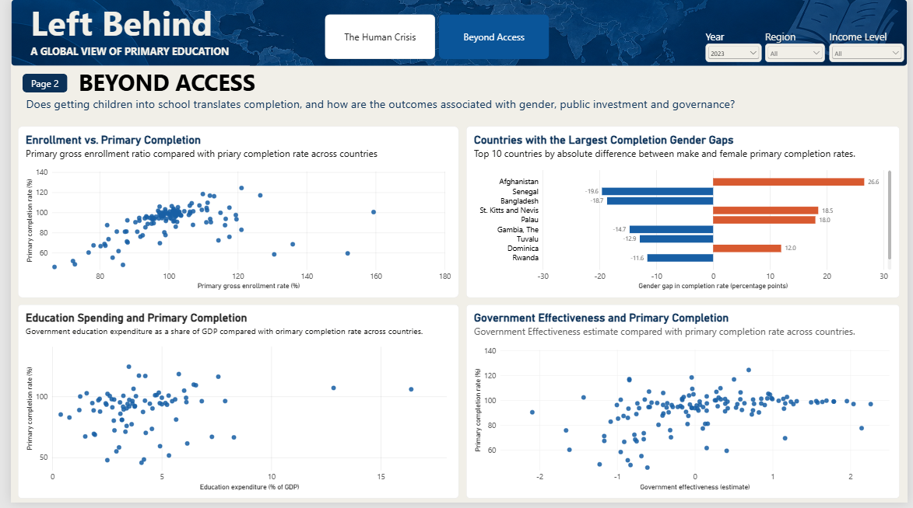

# Left Behind: A Global Analysis of Primary Education Access and Equity

Left Behind is a Power BI portfolio project examining primary education access and equity worldwide. It explores the scale and geography of children out of school, gender disparities, enrollment and completion outcomes, and contextual comparisons involving education spending and government effectiveness.

## Dashboard Preview

### The Human Crisis

### Beyond Access

## Key Questions
- Where is primary-school exclusion most concentrated?
- How do out-of-school counts and rates differ by gender?
- Do enrollment levels align with completion outcomes?
- How do completion outcomes compare with education spending and government effectiveness?

## Data and Methodology
The project draws on World Bank World Development Indicators, UNESCO Institute for Statistics population denominators, World Bank Worldwide Governance Indicators, and country-boundary GeoJSON. Out-of-school rates use out-of-school counts divided by the corresponding primary-school-age population. Education spending is shown as a percentage of GDP.

The spending and governance charts are exploratory comparisons and do not establish causation. Data availability varies by country, indicator, and year. See `docs/` for source details and limitations.

## Repository Contents
- `dashboard/` — Power BI report file
- `docs/` — technical documentation, methodology, data dictionary, visual inventory, data sources, limitations, and reproduction guide
- `assets/` — dashboard screenshots and data-model image
- `data/` — notes on source data availability and access

## How to Explore
1. Open the PBIX in Microsoft Power BI Desktop.
2. Use the Year slicer to explore 2010–2023; 2023 is the benchmark shown in the screenshots.
3. Explore **The Human Crisis** for out-of-school counts, rates, geography, and gender exclusion.
4. Explore **Beyond Access** for enrollment/completion and spending/governance comparisons.
5. Use Region and Income Level slicers; Page 1 also includes a Country slicer.

## Important Caveats
- Missing observations are not zero.
- Coverage varies across countries and indicators.
- Gross enrollment ratios can exceed 100%.
- Spending and governance comparisons are not causal.
- DAX formulas and some interaction settings remain pending final verification.

> Draft: confirm repository paths, source versions, licensing, and the final PBIX before public release.
